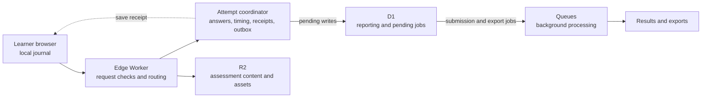

# QFlow Deliver

QFlow Deliver is an open-source assessment delivery platform built on Cloudflare Workers. Workers handle incoming requests across Cloudflare’s network. Each learner attempt has its own coordinator that stores answers, tracks time, and accepts submissions.

Assessment traffic often arrives in bursts. A cohort starts together, saves answers during a timed session, and finishes near the same deadline. Deliver saves learner work before it confirms success. Reporting, exports, and learning management system (LMS) updates run separately, so learners can receive confirmation while that work is still pending.

Use [QFlow Author](https://github.com/QFlowLearn/qflow-author), or import Question and Test Interoperability (QTI) packages from another authoring system. The independent [QTI library](https://github.com/QFlowLearn/qti3) renders items and processes responses.

## Why edge workers fit assessment delivery

[Cloudflare Workers](https://developers.cloudflare.com/workers/reference/how-workers-works/) distribute HTTP request handling across Cloudflare’s network. Cloudflare manages the compute capacity as traffic changes.

Each request for an attempt goes to that attempt’s [Durable Object](https://developers.cloudflare.com/durable-objects/concepts/what-are-durable-objects/): a coordinator with persistent storage. The coordinator stores accepted responses and applies timing and access policies. Different attempts have separate coordinators; requests for the same attempt reach the same coordinator.

This model addresses common delivery conditions:

| Delivery condition                               | How Deliver handles it                                                                                                                                             |
| ------------------------------------------------ | ------------------------------------------------------------------------------------------------------------------------------------------------------------------ |
| Many learners start or finish together           | Workers handle incoming requests, and each attempt has its own coordinator.                                                                                        |
| A learner saves an answer                        | The coordinator saves the updated state, a confirmation receipt, and a record of pending background work in one transaction. It then returns the receipt.          |
| A connection drops and the browser retries       | Each event has an idempotency key: an identifier that prevents duplicate processing. If the event was already accepted, the coordinator returns its saved receipt. |
| A learner closes the tab or loses the connection | The coordinator tracks time and uses server-side alarms to enforce deadlines.                                                                                      |
| Reporting or result processing is delayed        | The coordinator keeps an outbox of pending work and retries delivery. Queues process submissions and exports separately from saving learner responses.             |

## How an answer is saved

1. The browser saves the response event in its local journal and sends it with an idempotency key.
2. A Worker checks the request and routes it to the attempt’s coordinator.
3. The coordinator checks the attempt’s state and policy. It saves the accepted state, receipt, and outbox entry in one transaction.
4. The browser receives the receipt and marks the response as confirmed by the server.
5. The outbox copies accepted events into D1 for reporting and further processing. Separate jobs finalize submissions and produce exports.

If the connection drops, the browser keeps pending updates in its journal and retries them when the connection returns. A locally saved response remains visibly pending until the server confirms it. The attempt’s timing and access policies determine whether a replayed update can be accepted. Deliver records late evidence separately from accepted work.



## Content and LMS connections

Each attempt uses a fixed published assessment version. Later authoring changes leave that version intact. Deliver stores QTI content and assets separately from learner responses.

The learner and instructor interfaces support accommodations, timing policies, manual scoring, and reporting. LMS connections use Learning Tools Interoperability (LTI) 1.3 for Deep Linking, grade return, and roster access. OneRoster supports roster provisioning. Deliver records integration processing and audit events separately from learner responses.

## Architecture

| Component            | Responsibility                                                                                                               |
| -------------------- | ---------------------------------------------------------------------------------------------------------------------------- |
| Workers              | Handle HTTP requests, authenticate users, launch attempts, and serve content.                                                |
| Durable Objects      | Coordinate individual attempts, save responses and receipts, enforce timing and policy, and retry pending background writes. |
| D1                   | Store tenant and assignment records, roster and LMS data, reporting data, and result-processing status.                      |
| R2                   | Store published assessment packages, extracted content, media, and exports.                                                  |
| Queues and Workflows | Finalize submissions, produce exports, and run result-repair operations.                                                     |

The application is written in TypeScript. Source code is organized into three directories:

- `apps/harbor-web/`: learner and instructor interface
- `workers/runtime/`: Worker APIs and attempt processing
- `packages/`: shared protocols, content models, and database schema

To follow a response through the code, start with the [browser journal](apps/harbor-web/src/lib/attempt-journal.ts), [attempt coordinator](workers/runtime/src/attempts/attempt-durable-object.ts), [transactional outbox](workers/runtime/src/attempts/attempt-commit-outbox.ts), and [submission finalization](workers/runtime/src/queues/submit-finalization.ts).

## Run locally

Install Node 26.12.0 and pnpm 12.21.0. Then run:

```sh
pnpm install --frozen-lockfile
pnpm dev
```

The development command starts the local Worker and web application, prepares sample data, and prints the learner and staff URLs. Stop it with Ctrl+C.

The local configuration uses synthetic test credentials and emulated storage. Use it only for isolated development, without real learner data.

The Worker uses `workers/runtime/cloudflare.config.ts` and the Cloudflare Vite plugin. `runtime-config.ts` holds its binding and trigger definitions. Local state stays under `workers/runtime/.wrangler/state`; staff browser tests use `.wrangler/staff-e2e` with authentication bypasses disabled. The directory names retain the previous local storage paths.

The current Cloudflare CLI requires a valid UUID for D1. The local fixture database now uses `00000000-0000-4000-8000-000000000001`, which creates a new database namespace. Existing database files remain intact, but the development commands do not migrate their data. Run `pnpm dev` to prepare fresh sample data.

Optional: Run `pnpm dev:preview`, `pnpm dev:services`, or `pnpm dev:access-code` for a specific development mode.

The default demo uses generated sample data. To use your own QTI ZIP, set `QFLOW_DEMO_PACKAGE` to the file path and run `pnpm dev -- --demo-source zip`. The command reports an error if the path is missing or invalid.

## Check changes

Run the following checks:

```sh
pnpm typecheck
pnpm test
pnpm build:web
pnpm build:worker
pnpm test:e2e:delivery
pnpm test:e2e:staff
```

Before running browser tests, install Chromium with `pnpm exec playwright install chromium`. Run `pnpm verify` for formatting, lint, type checks, unit tests, and both builds. CI also runs both browser suites.

See [CONTRIBUTING.md](CONTRIBUTING.md) for contribution guidelines. Report vulnerabilities privately through the repository’s **Security → Report a vulnerability** form.

## License

QFlow Deliver uses the **GNU Affero General Public License v3 (AGPL v3)**. See [LICENSE](LICENSE). Third-party components retain their own license notices.
