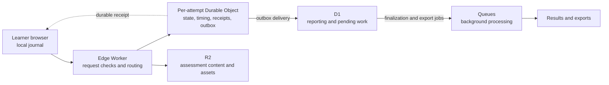

# QFlow Deliver

QFlow Deliver is an open-source assessment delivery platform built on Cloudflare Workers. It combines a distributed request layer with a durable coordinator for each learner attempt, so saving answers, enforcing timing, and accepting submissions have a clear owner.

Assessment traffic often arrives in bursts: a cohort starts together, saves answers throughout a timed session, and finishes near the same deadline. Deliver separates those immediate learner interactions from reporting, exports, and LMS updates. Each part can do its work without holding up the acknowledgement that a learner’s response has been saved.

Use [QFlow Author](https://github.com/QFlowLearn/qflow-author), or bring QTI packages from another authoring system. The independent [QTI library](https://github.com/QFlowLearn/qti3) handles item rendering and response processing.

## Why edge workers fit assessment delivery

[Cloudflare Workers](https://developers.cloudflare.com/workers/reference/how-workers-works/) run the HTTP application across Cloudflare’s network. This distributes request handling and lets the platform manage compute capacity as traffic changes. Assessment state has a separate, explicit home: each attempt is routed by its ID to a [Durable Object](https://developers.cloudflare.com/durable-objects/concepts/what-are-durable-objects/) with persistent storage.

That division maps directly to the work of delivering an assessment:

| Assessment need                                     | How Deliver handles it                                                                                                                                    |
| --------------------------------------------------- | --------------------------------------------------------------------------------------------------------------------------------------------------------- |
| Many learners start or finish together              | Workers handle incoming requests; separate Durable Objects coordinate separate attempts. Learners do not share one application-level response-write lock. |
| A learner saves an answer                           | The attempt coordinator commits the updated state, a receipt, and pending downstream work in one storage transaction before acknowledging acceptance.     |
| A request is retried after a connection drops       | An idempotency key identifies the event. Replaying an accepted event returns its recorded receipt without applying the response twice.                    |
| Timing must survive a closed tab or lost connection | The coordinator owns timing state and uses server-side alarms for deadline enforcement. Browser activity is not required to trigger a deadline.           |
| Reporting or result processing is delayed           | A durable outbox retries downstream writes. Queues handle submission finalization and result exports separately from accepting learner work.              |

The HTTP layer is distributed; an individual attempt’s authoritative state lives with its coordinator. This gives retries, policy changes, deadlines, and submission a consistent place to resolve, even when requests arrive through different Workers.

## What happens when an answer is saved

1. The browser records the response event in its local journal and sends it with an idempotency key.
2. A Worker checks the request and routes it to the coordinator for that attempt.
3. The coordinator checks attempt state and policy, then atomically stores the accepted state, receipt, and outbox entry.
4. The browser receives the durable receipt and can distinguish server-confirmed work from changes still waiting to sync.
5. The outbox projects accepted events into D1. Submission finalization, result exports, and other downstream operations proceed through their own processing paths.

The local journal retains pending updates for replay after a connection returns. A response saved in the browser remains visibly pending until the server confirms it. Recovery is subject to the attempt’s timing and access policy; late evidence is recorded separately from accepted work.



## Content, delivery, and integrations

Published assessment versions are immutable. Attempts refer to a specific version, so later authoring changes do not silently alter an assessment already in progress. QTI content and assets are stored separately from learner responses.

Deliver provides learner and instructor interfaces, accommodations, timing policies, manual scoring, and result reporting. LMS connections use LTI 1.3, including Deep Linking, grade return, and roster access. OneRoster supports institutional provisioning workflows. These integrations have their own processing and audit records.

## Architecture

| Component            | Responsibility                                                                                             |
| -------------------- | ---------------------------------------------------------------------------------------------------------- |
| Workers              | HTTP APIs, authentication, launch, request routing, and content access.                                    |
| Durable Objects      | Per-attempt state transitions, response acceptance, timing, policy, receipts, and durable outbox recovery. |
| D1                   | Tenant and assignment records, roster and LMS data, reporting projections, and result-processing ledgers.  |
| R2                   | Immutable assessment packages, extracted content, media, and export artifacts.                             |
| Queues and Workflows | Submission finalization, result exports, and durable result-remediation operations.                        |

The implementation is TypeScript. The web interface lives in `apps/harbor-web/`, the Worker runtime in `workers/runtime/`, and shared protocols, content models, and database schema in `packages/`.

For the core delivery path, see the [attempt coordinator](workers/runtime/src/attempts/attempt-durable-object.ts), [transactional outbox](workers/runtime/src/attempts/attempt-commit-outbox.ts), [browser journal](apps/harbor-web/src/lib/attempt-journal.ts), and [submission finalization](workers/runtime/src/queues/submit-finalization.ts).

## Run locally

Install Node 24 and pnpm 10.29.2.

```sh
pnpm install --frozen-lockfile
pnpm dev
```

The foreground development command starts the local Worker and web application, prepares local fixtures, and prints the learner and staff URLs. Stop it with Ctrl+C. Local configuration contains synthetic test credentials and emulated storage. Do not expose it as a production service or use it with real learners.

Optional modes are `pnpm dev:preview`, `pnpm dev:services`, and `pnpm dev:access-code`. The default demo uses generated fixtures. To use your own QTI ZIP, set `QFLOW_DEMO_PACKAGE` to its path and run `pnpm dev -- --demo-source zip`. An absent or invalid path is an error.

## Development

```sh
pnpm typecheck
pnpm test
pnpm build:web
pnpm test:e2e:delivery
```

Run `pnpm verify` for all checks. Browser tests require `pnpm exec playwright install chromium`.

See [CONTRIBUTING.md](CONTRIBUTING.md). Report vulnerabilities privately through the repository’s **Security → Report a vulnerability** form.

## License

Licensed under the **GNU Affero General Public License v3 (AGPL v3)**. See [LICENSE](LICENSE). Third-party components retain their own license notices.
